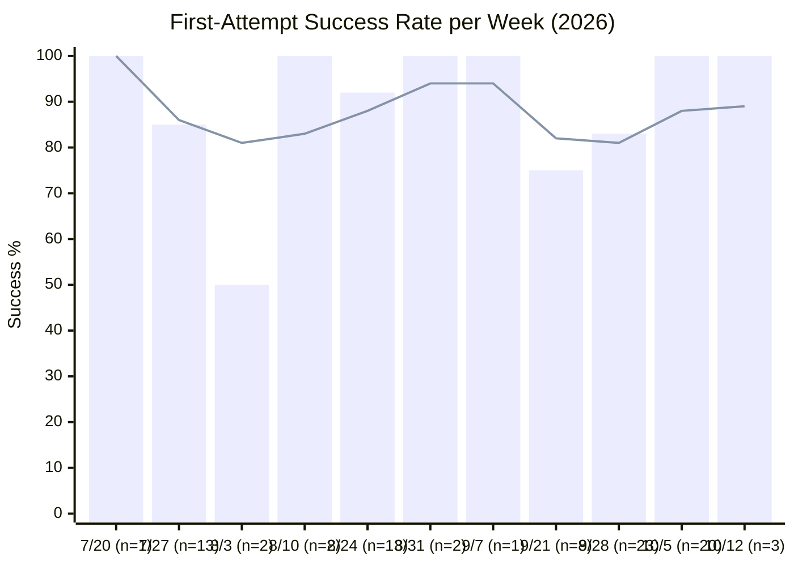
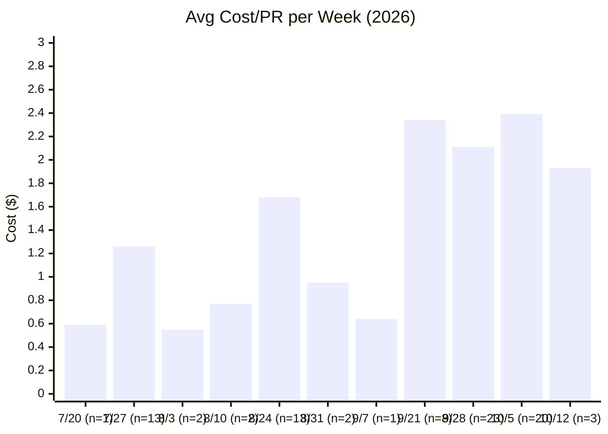
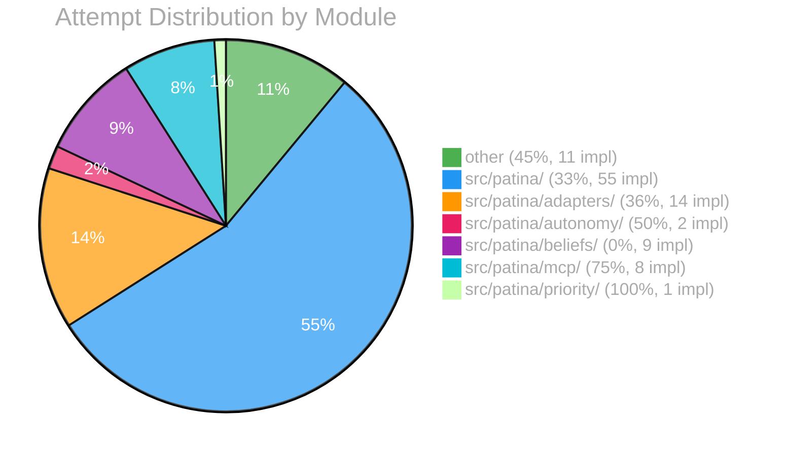

# EVAL Report

## Overall

| Metric | Value |
|--------|-------|
| First-attempt success | 76% |
| Avg cost/PR | $0.81 |
| Human edit rate | 28% |

## Auto-Merge Gate (repo-level)

| Metric | Value | Threshold |
|--------|-------|----------|
| Success rate | 76% | >90% |
| Edit rate | 28% | <5% |
| Clean merges | 71 | ≥10 |
| **Ready?** | **No** | |

## Per-Module Breakdown

| Module | Success | Avg Cost | Impl | Auto-merge ready? |
|--------|---------|----------|------|--------------------|
| other | 45% | $0.79 | 11 | No |
| src/patina/ | 33% | $0.70 | 55 | No |
| src/patina/adapters/ | 36% | $0.39 | 14 | No |
| src/patina/autonomy/ | 50% | $1.94 | 2 | No |
| src/patina/beliefs/ | 0% | $0.00 | 9 | No |
| src/patina/mcp/ | 75% | $0.52 | 8 | No |
| src/patina/priority/ | 100% | $1.91 | 1 | No |

## Trend

| Week | Implementations | First-attempt | Avg Cost |
|------|----------------|---------------|----------|
| 2026-07-20 | 1 | 100% | $0.59 |
| 2026-07-27 | 13 | 85% | $1.26 |
| 2026-08-03 | 2 | 50% | $0.55 |
| 2026-08-10 | 2 | 100% | $0.77 |
| 2026-08-24 | 13 | 92% | $1.68 |
| 2026-08-31 | 2 | 100% | $0.95 |
| 2026-09-07 | 1 | 100% | $0.64 |
| 2026-09-21 | 8 | 75% | $2.34 |
| 2026-09-28 | 23 | 83% | $2.11 |
| 2026-10-05 | 20 | 100% | $2.39 |
| 2026-10-12 | 3 | 100% | $1.93 |

