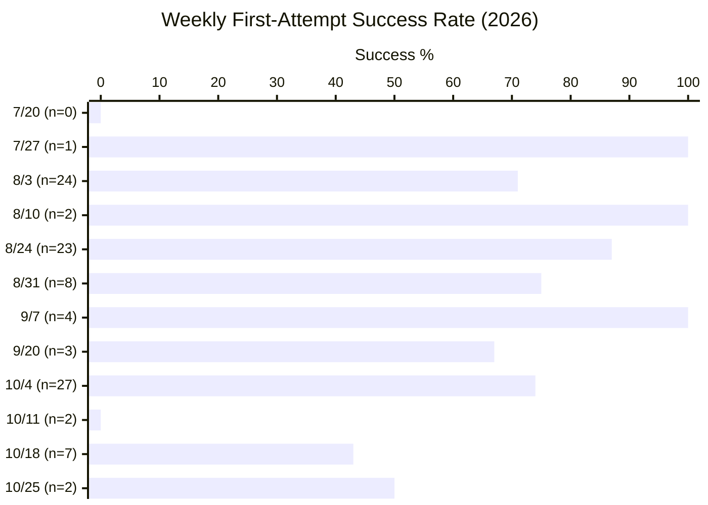
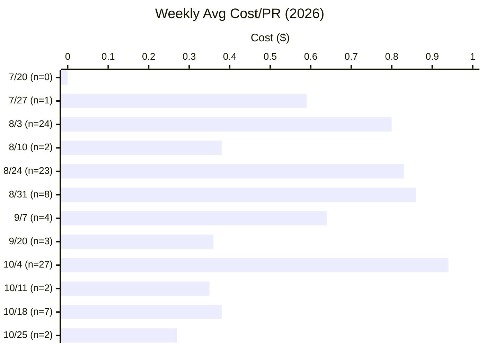
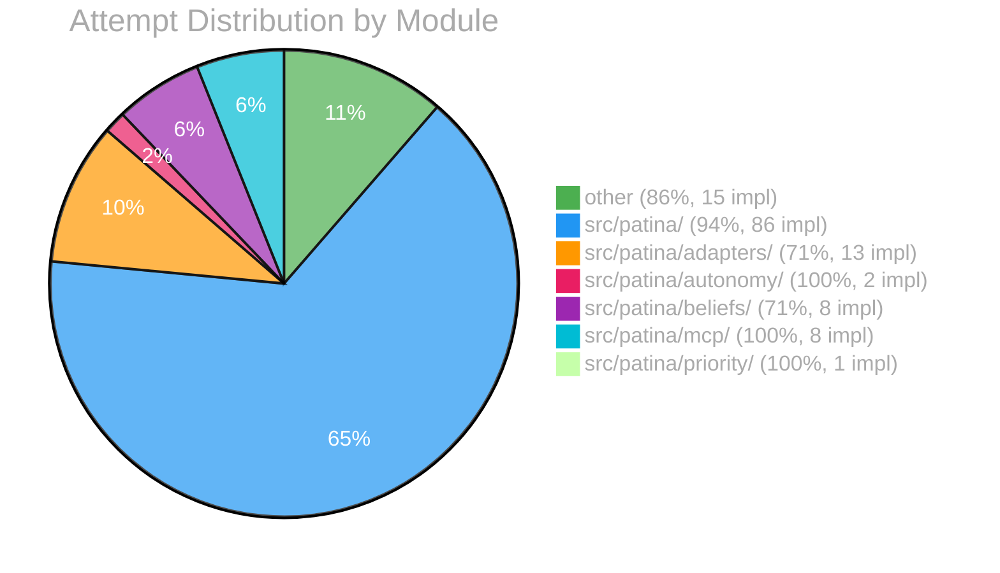

# EVAL Report

Report date 2026-10-28: data as of 2026-10-28T05:06:52.381931+00:00, 224 history rows.

## Overall

| Metric | Value | Pending |
|--------|-------|---------|
| Total PRs | 127 | — |
| First-attempt success | 88% (n=121 implement runs) | pending: 0 |
| Avg cost/run | $1.94 (n=121 implement runs) | included |
| Avg review cost/run | $0.27 (n=9 implement runs) | included |
| Human edit rate | 28% (n=127 merged PRs; edited by a human PR within 7 days) | pending: 0 |

## Definitions

| Metric | Numerator | Denominator | Counts | Window |
|--------|-----------|-------------|--------|--------|
| First-attempt success | implement runs that succeeded with attempts == 1 | implement runs with an outcome (pending runs excluded) | `run_history` rows with type "implement" and a non-zero issue (triage, review and issue-0 rows are excluded) | Overall: lifetime. Trend: change since the previous snapshot (snapshots without outcome counts use the attempt distribution) |
| Human edit rate | merged PRs with a non-autoloop PR merged within the fixup window that touches the same files (bookkeeping files, release and eval-report PRs are ignored) | merged PRs (open PRs are pending; closed unmerged PRs excluded) | PRs from `autoloop/` branches, up to the 500 most recent | Overall: lifetime. Trend: new edits / new merges since the previous snapshot; invalid when edits exceed merges (older PRs flagged late) |
| Avg cost/run | sum of implementation cost over implement runs: `impl_cost_usd` when logged, else `cost_usd` (rows before #451 never included review cost) | implement runs, pending included (cost is known when a run ends) | `run_history` rows with type "implement" and a non-zero issue (triage, review and issue-0 rows are excluded) | Overall: lifetime. Trend: change in total cost / change in implement runs |
| Avg review cost/run | sum of `review_cost_usd` over implement runs that logged it | implement runs with `review_cost_usd` (none is imputed for older rows) | `run_history` rows with type "implement" and a non-zero issue (triage, review and issue-0 rows are excluded); logged from #451 onward only | Overall: lifetime, shown only when n > 0 |

Pending: a successful implement run whose PR is still open, or an open PR. Pending items are left out of outcome-dependent denominators and shown as a separate pending count. Any rate whose numerator exceeds its denominator renders as invalid.

## Auto-Merge Gate (repo-level)

| Metric | Value | Threshold |
|--------|-------|-----------|
| Success rate | 88% | >90% |
| Edit rate | 28% | <5% |
| Clean merges | 91 | ≥10 |
| **Ready?** | **No** | |

## Per-Module Breakdown

| Module | Success | Avg Cost | Impl | Auto-merge ready? |
|--------|---------|----------|------|--------------------|
| other | insufficient data (n=14 runs) | insufficient data (n=14 runs) | 15 | No |
| src/patina/ | 94% (n=81 runs) | $2.10 (n=81 runs) | 86 | No |
| src/patina/adapters/ | insufficient data (n=7 runs) | insufficient data (n=7 runs) | 13 | No |
| src/patina/autonomy/ | insufficient data (n=2 runs) | insufficient data (n=2 runs) | 2 | No |
| src/patina/beliefs/ | insufficient data (n=7 runs) | insufficient data (n=7 runs) | 8 | No |
| src/patina/mcp/ | insufficient data (n=6 runs) | insufficient data (n=6 runs) | 8 | No |
| src/patina/priority/ | insufficient data (n=1 runs) | insufficient data (n=1 runs) | 1 | No |

## Trend

| Date (UTC) | New PRs | First-attempt | Avg Cost | Human Edits |
|------|---------|---------------|----------|-------------|
| 2026-07-20 | 14 | 0% | $0.00 | 0% |
| 2026-07-27 | 1 | 100% | $0.59 | 0% |
| 2026-08-03 | 14 | 71% | $0.80 | 21% |
| 2026-08-10 | 1 | 100% | $0.38 | 100% |
| 2026-08-24 | 9 | 87% | $0.83 | 0% |
| 2026-08-31 | 6 | 75% | $0.86 | 0% |
| 2026-09-07 | 2 | 100% | $0.64 | 50% |
| 2026-09-19 | 1 | 100% | $0.15 | 0% |
| 2026-09-20 | 0 | 0% | $0.77 | — |
| 2026-09-21 | 0 | — | — | — |
| 2026-09-22 | 0 | — | — | — |
| 2026-09-23 | 0 | — | — | — |
| 2026-09-24 | 0 | — | — | — |
| 2026-09-25 | 0 | — | — | — |
| 2026-09-26 | 0 | — | — | — |
| 2026-09-28 | 8 | 70% | $2.04 | 0% |
| 2026-09-29 | 1 | 100% | $0.18 | 0% |
| 2026-09-30 | 0 | — | — | — |
| 2026-10-01 | 0 | — | — | — |
| 2026-10-03 | 11 | 92% | $0.18 | 0% |
| 2026-10-04 | 10 | 0% | $0.82 | 0% |
| 2026-10-05 | 2 | 0% | $0.00 | 0% |
| 2026-10-06 | 3 | 0% | $0.81 | 0% |
| 2026-10-07 | 0 | — | — | — |
| 2026-10-08 | 2 | — | — | — |
| 2026-10-09 | 9 | — | — | — |
| 2026-10-10 | 4 | — | — | — |
| 2026-10-11 | 0 | — | — | — |
| 2026-10-12 | 4 | 0% | $0.81 | — |
| 2026-10-13 | 1 | — | — | — |
| 2026-10-14 | 2 | 50% | $0.33 | 0% |
| 2026-10-15 | 3 | 0% | $0.80 | 0% |
| 2026-10-17 | 1 | 100% | $0.00 | invalid |
| 2026-10-18 | 1 | 50% | $0.28 | 100% |
| 2026-10-19 | 4 | 0% | $0.78 | 0% |
| 2026-10-20 | 0 | — | — | — |
| 2026-10-21 | 1 | 100% | $0.00 | — |
| 2026-10-22 | 0 | — | — | — |
| 2026-10-23 | 0 | — | — | — |
| 2026-10-24 | 0 | — | — | — |
| 2026-10-25 | 0 | — | — | — |
| 2026-10-26 (baseline break) | 1 | 87% | $1.98 | 43% |
| 2026-10-27 | 3 | 100% | $1.70 | — |
| 2026-10-28 (baseline break) | 9 | 100% | $1.57 | 28% |

> Baseline break at 2026-10-26: earlier snapshots counted triage runs as implementations (#400), so their first-attempt and cost values are not comparable with later rows.

> Baseline break at 2026-10-28: human edits are counted under a 7-day window from this row on, so earlier human edit rates are not comparable with later rows.

