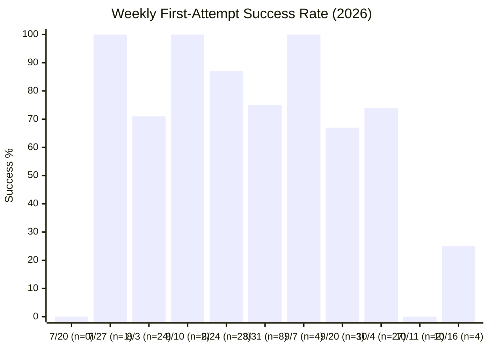
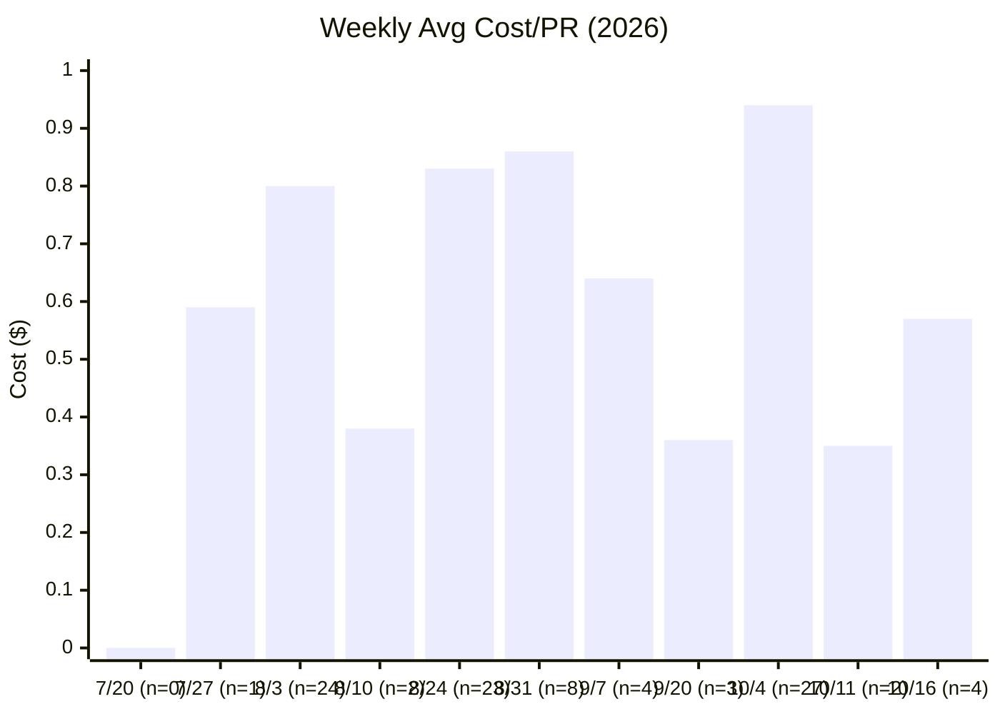
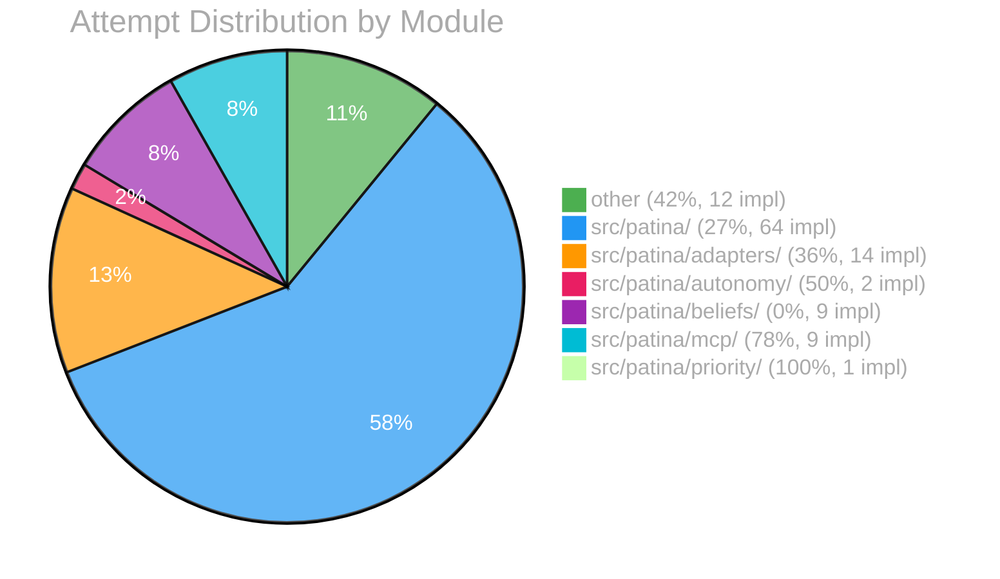

# EVAL Report

## Overall

| Metric | Value |
|--------|-------|
| First-attempt success | 73% |
| Avg cost/PR | $0.80 |
| Human edit rate | 35% |

## Auto-Merge Gate (repo-level)

| Metric | Value | Threshold |
|--------|-------|-----------|
| Success rate | 73% | >90% |
| Edit rate | 35% | <5% |
| Clean merges | 70 | ≥10 |
| **Ready?** | **No** | |

## Per-Module Breakdown

| Module | Success | Avg Cost | Impl | Auto-merge ready? |
|--------|---------|----------|------|--------------------|
| other | 42% | $0.73 | 12 | No |
| src/patina/ | 27% | $0.59 | 64 | No |
| src/patina/adapters/ | 36% | $0.39 | 14 | No |
| src/patina/autonomy/ | 50% | $1.94 | 2 | No |
| src/patina/beliefs/ | 0% | $0.00 | 9 | No |
| src/patina/mcp/ | 78% | $0.56 | 9 | No |
| src/patina/priority/ | 100% | $1.91 | 1 | No |

## Trend

| Date (UTC) | Implementations | First-attempt | Avg Cost | Human Edits |
|------|----------------|---------------|----------|-------------|
| 2026-07-20 | 14 | 0% | $0.00 | 0% |
| 2026-07-27 | 1 | 100% | $0.59 | 0% |
| 2026-08-03 | 14 | 71% | $0.80 | 21% |
| 2026-08-10 | 1 | 100% | $0.38 | 100% |
| 2026-08-24 | 9 | 87% | $0.83 | 0% |
| 2026-08-31 | 6 | 75% | $0.86 | 0% |
| 2026-09-07 | 2 | 100% | $0.64 | 50% |
| 2026-09-19 | 1 | 100% | $0.15 | 0% |
| 2026-09-20 | 0 | 0% | $0.77 | — |
| 2026-09-21 | 0 | — | — | — |
| 2026-09-22 | 0 | — | — | — |
| 2026-09-23 | 0 | — | — | — |
| 2026-09-24 | 0 | — | — | — |
| 2026-09-25 | 0 | — | — | — |
| 2026-09-26 | 0 | — | — | — |
| 2026-09-28 | 8 | 70% | $2.04 | 0% |
| 2026-09-29 | 1 | 100% | $0.18 | 0% |
| 2026-09-30 | 0 | — | — | — |
| 2026-10-01 | 0 | — | — | — |
| 2026-10-03 | 11 | 92% | $0.18 | 0% |
| 2026-10-04 | 10 | 0% | $0.82 | 0% |
| 2026-10-05 | 2 | 0% | $0.00 | 0% |
| 2026-10-06 | 3 | 0% | $0.81 | 0% |
| 2026-10-07 | 0 | — | — | — |
| 2026-10-08 | 2 | — | — | — |
| 2026-10-09 | 9 | — | — | — |
| 2026-10-10 | 4 | — | — | — |
| 2026-10-11 | 0 | — | — | — |
| 2026-10-12 | 4 | 0% | $0.81 | — |
| 2026-10-13 | 1 | — | — | — |
| 2026-10-14 | 2 | 50% | $0.33 | 0% |
| 2026-10-15 | 3 | 0% | $0.80 | 0% |
| 2026-10-16 | 0 | — | — | — |

