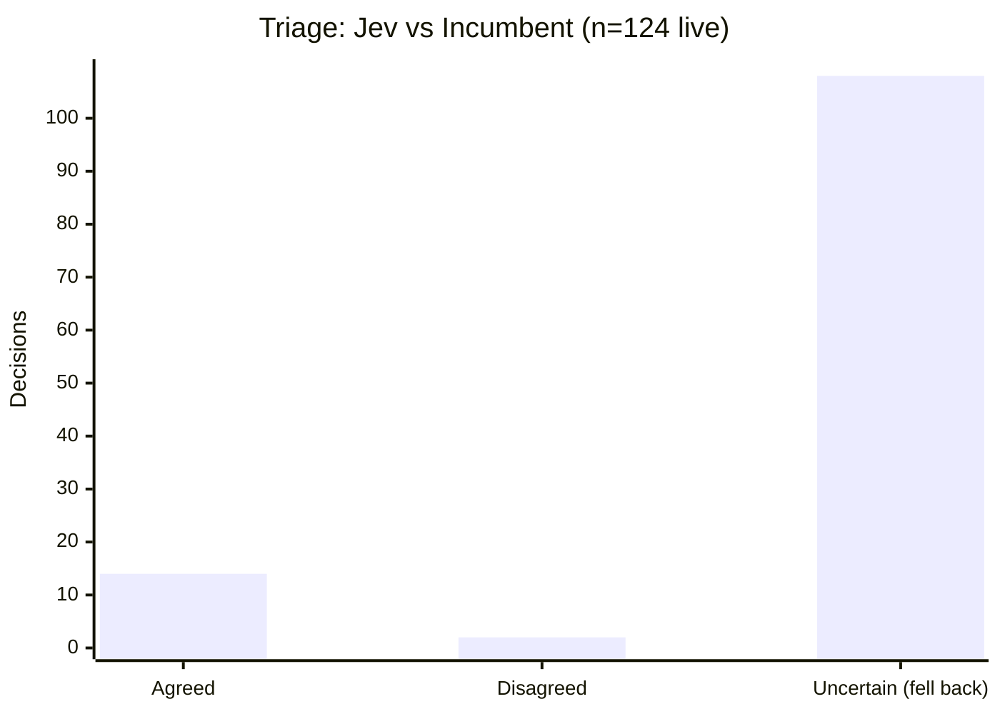
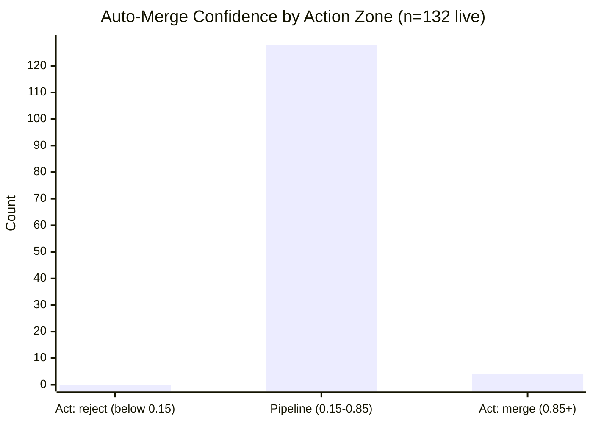
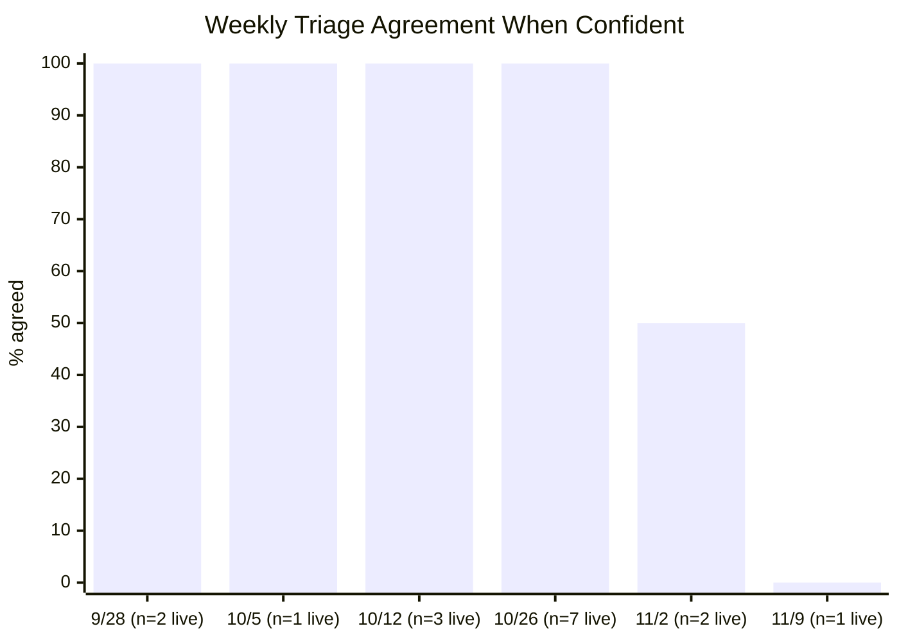
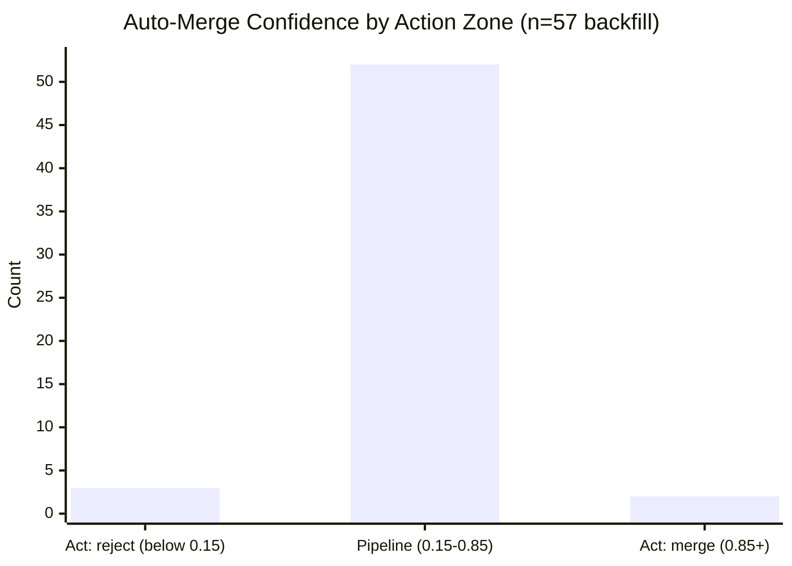

# JEV Report

**Verdict:** Jev agreed on 88% (n=16 live) of confident calls

**Band:** 0.15–0.85 (from config)

## Charts

## Counts

- **Total entries:** 348
- **Live entries:** 276
- **Backfilled entries:** 72
- **Date range:** 2026-07-03 to 2026-11-09

## Triage Agreement

- **Agreed:** 14 of 124
- **Disagreed:** 2 of 124
- **Uncertain (fell back):** 108 of 124
- **When confident, agreed:** 14 of 16 — 88% (n=16 live)
- **Disagreement breakdown:**
  - needs-decomposition-vs-rejected: 2

### Weekly Trends

| Week | Agreed | Disagreed | Uncertain | n |
|------|--------|-----------|-----------|---|
| 9/28 | 2 | 0 | 9 | 11 |
| 10/5 | 1 | 0 | 7 | 8 |
| 10/12 | 3 | 0 | 24 | 27 |
| 10/19 | 0 | 0 | 3 | 3 |
| 10/26 | 7 | 0 | 31 | 38 |
| 11/2 | 1 | 1 | 30 | 32 |
| 11/9 | 0 | 1 | 4 | 5 |

## Auto-Merge Agreement

- **Mean confidence:** 0.552 (n=132 live)
- **Median confidence:** 0.555 (n=132 live)
- **Agreement with incumbent decision:** 44/61 — 72% (n=61 live)

### Per-Zone Agreement

| Zone | Agreed | Total | Agreement |
|------|--------|-------|-----------|
| Act: reject (below 0.15) | — | 0 | no outcomes yet |
| Pipeline (0.15-0.85) | 44 | 61 | 72% (n=61 live) |
| Act: merge (0.85+) | — | 0 | no outcomes yet |

## Calibration

Live rows only; shadow and backfilled rows are excluded. A suggested band edge needs Jev to match the incumbent on at least 95% of the calls beyond it, with at least n=30 calls.

### triage.well_formed

| Bin | n | % not rejected |
|-----|---|---|
| 0–0.15 | n=1 | 0% |
| 0.15–0.35 | n=0 | — |
| 0.35–0.5 | n=0 | — |
| 0.5–0.65 | n=0 | — |
| 0.65–0.85 | n=21 | 76% |
| 0.85–1 | n=122 | 84% |

- **Suggested band edges:** no edge reaches 95% (n=144)
- **Baseline:** always accept: 83%, n=144 vs Jev: 83%, n=144

### triage.needs_decomposition

| Bin | n | % needs-decomposition |
|-----|---|---|
| 0–0.15 | n=7 | 0% |
| 0.15–0.35 | n=36 | 8% |
| 0.35–0.5 | n=22 | 9% |
| 0.5–0.65 | n=29 | 17% |
| 0.65–0.85 | n=39 | 46% |
| 0.85–1 | n=11 | 73% |

- **Suggested band edges:** no edge reaches 95% (n=144)
- **Baseline:** never decompose: 75%, n=144 vs Jev: 63%, n=144

### auto-merge.meets_acceptance_criteria

| Bin | n | % approved |
|-----|---|---|
| 0–0.15 | n=0 | — |
| 0.15–0.35 | n=8 | 88% |
| 0.35–0.5 | n=11 | 73% |
| 0.5–0.65 | n=30 | 93% |
| 0.65–0.85 | n=12 | 100% |
| 0.85–1 | n=0 | — |

- **Suggested band edges:** low: not enough data; high 0.5 (95%, n=42)
- **Baseline:** always approve: 90%, n=61 vs Jev: 72%, n=61

## Backfill

### Backfill Auto-Merge Agreement

- **Mean confidence:** 0.465 (n=57 backfill)
- **Median confidence:** 0.360 (n=57 backfill)
- **Agreement with incumbent decision:** 14/45 — 31% (n=45 backfill)

### Per-Zone Agreement

| Zone | Agreed | Total | Agreement |
|------|--------|-------|-----------|
| Act: reject (below 0.15) | 0 | 3 | 0% (n=3 backfill) |
| Pipeline (0.15-0.85) | 14 | 42 | 33% (n=42 backfill) |
| Act: merge (0.85+) | — | 0 | no outcomes yet |

## Legend

- **Incumbent decision:** the human/pipeline decision that was actually used
- **Fell back:** Jev returned an uncertain result and deferred to the incumbent
- **Pipeline (0.15–0.85):** confidence too close to call; Jev defers to the incumbent
- **Backfilled:** a decision reconstructed from historical data, not made live
- **n=… live / n=… backfill:** the sample behind a number; live and backfilled decisions are never pooled

---

*Generated at 2026-11-09 15:37 UTC*