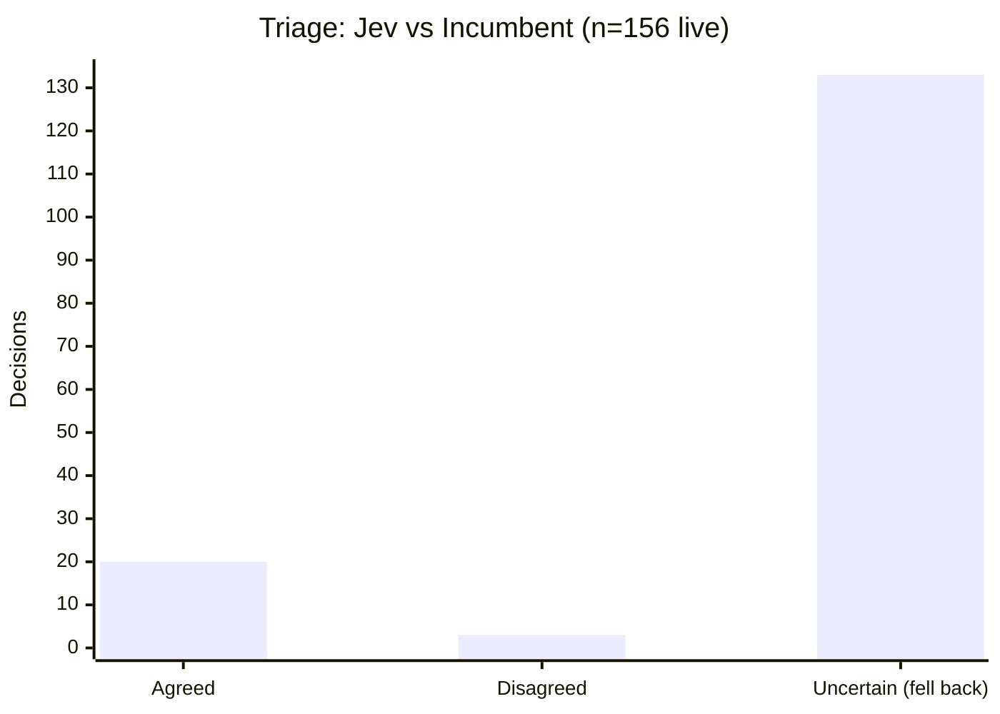
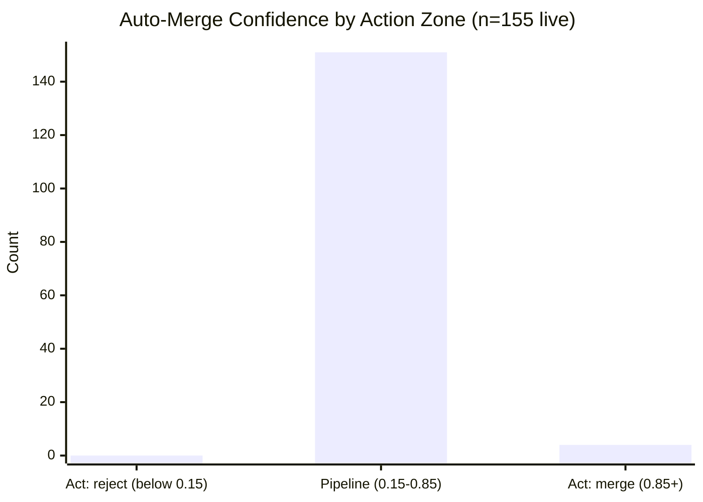
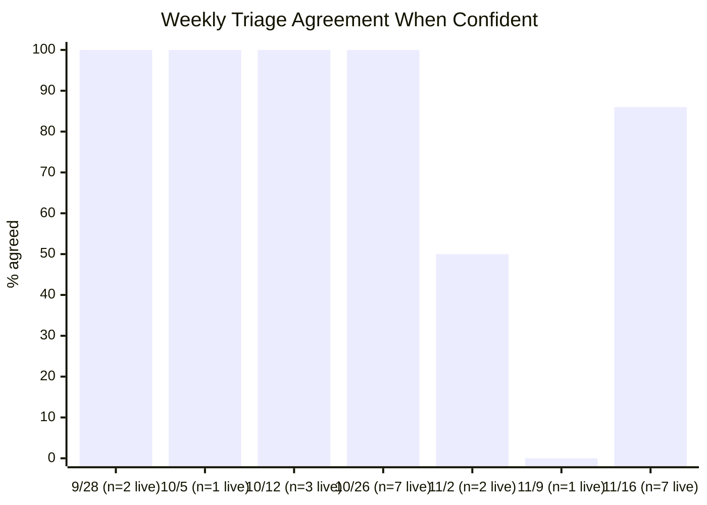
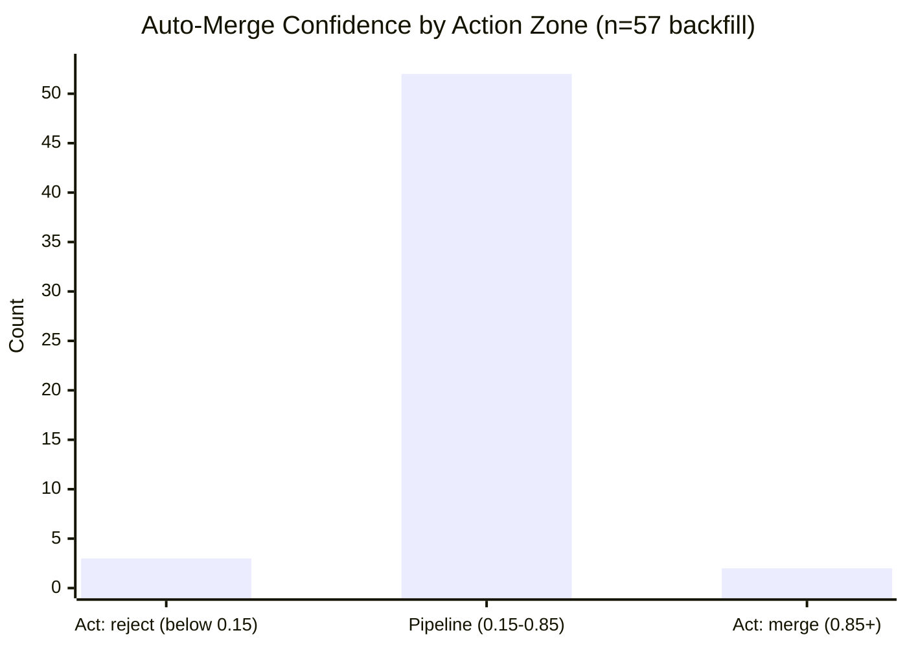

# JEV Report

**Verdict:** Jev agreed on 87% (n=23 live) of confident calls

**Band:** 0.15–0.85 (from config); triage.needs_decomposition: 0.35–0.85

## Charts

## Counts

- **Total entries:** 403
- **Live entries:** 331
- **Backfilled entries:** 72
- **Date range:** 2026-07-03 to 2026-11-24

## Triage Agreement

- **Agreed:** 20 of 156
- **Disagreed:** 3 of 156
- **Uncertain (fell back):** 133 of 156
- **When confident, agreed:** 20 of 23 — 87% (n=23 live)
- **Disagreement breakdown:**
  - needs-decomposition-vs-rejected: 2
  - ready-vs-rejected: 1

### Weekly Trends

| Week | Agreed | Disagreed | Uncertain | n |
|------|--------|-----------|-----------|---|
| 9/28 | 2 | 0 | 9 | 11 |
| 10/5 | 1 | 0 | 7 | 8 |
| 10/12 | 3 | 0 | 24 | 27 |
| 10/19 | 0 | 0 | 3 | 3 |
| 10/26 | 7 | 0 | 31 | 38 |
| 11/2 | 1 | 1 | 30 | 32 |
| 11/9 | 0 | 1 | 5 | 6 |
| 11/16 | 6 | 1 | 22 | 29 |
| 11/23 | 0 | 0 | 2 | 2 |

## Auto-Merge Agreement

- **Mean confidence:** 0.554 (n=155 live)
- **Median confidence:** 0.560 (n=155 live)
- **Agreement with incumbent decision:** 60/84 — 71% (n=84 live)

### Per-Zone Agreement

| Zone | Agreed | Total | Agreement |
|------|--------|-------|-----------|
| Act: reject (below 0.15) | — | 0 | no outcomes yet |
| Pipeline (0.15-0.85) | 60 | 84 | 71% (n=84 live) |
| Act: merge (0.85+) | — | 0 | no outcomes yet |

## Calibration

Live rows only; shadow and backfilled rows are excluded. A suggested band edge needs Jev to match the incumbent on at least 95% of the calls beyond it, with at least n=30 calls.

### triage.well_formed

| Bin | n | % not rejected |
|-----|---|---|
| 0–0.15 | n=1 | 0% |
| 0.15–0.35 | n=0 | — |
| 0.35–0.5 | n=0 | — |
| 0.5–0.65 | n=0 | — |
| 0.65–0.85 | n=22 | 77% |
| 0.85–1 | n=153 | 84% |

- **Band:** 0.15–0.85 (from config)
- **Suggested band edges:** no edge reaches 95% (n=176)
- **Baseline:** always accept: 82%, n=176 vs Jev: 83%, n=176

### triage.needs_decomposition

| Bin | n | % needs-decomposition |
|-----|---|---|
| 0–0.15 | n=8 | 0% |
| 0.15–0.35 | n=40 | 8% |
| 0.35–0.5 | n=26 | 8% |
| 0.5–0.65 | n=33 | 15% |
| 0.65–0.85 | n=57 | 46% |
| 0.85–1 | n=12 | 75% |

- **Band:** 0.35–0.85 (from config)
- **Suggested band edges:** no edge reaches 95% (n=176)
- **Baseline:** never decompose: 74%, n=176 vs Jev: 62%, n=176

### auto-merge.meets_acceptance_criteria

| Bin | n | % approved (incumbent verdict) |
|-----|---|---|
| 0–0.15 | n=0 | — |
| 0.15–0.35 | n=9 | 89% |
| 0.35–0.5 | n=15 | 80% |
| 0.5–0.65 | n=43 | 91% |
| 0.65–0.85 | n=17 | 100% |
| 0.85–1 | n=0 | — |

- **Yardsticks:** **incumbent verdict** (approved), **final outcome** (merged), **7-day human edit** (no human edit). The incumbent's verdict is not ground truth.
- **Band:** 0.15–0.85 (from config)
- **Suggested band edges:** no edge reaches 95% (n=84)
- **Baseline:** always approve: 90%, n=84 vs Jev: 71%, n=84
- **Baseline (final outcome):** no data (no live rows with a merged or closed-unmerged final_outcome)
- **Baseline (7-day human edit):** no data (run history has no 7-day human-edit signal)

## Backfill

### Backfill Auto-Merge Agreement

- **Mean confidence:** 0.465 (n=57 backfill)
- **Median confidence:** 0.360 (n=57 backfill)
- **Agreement with incumbent decision:** 14/45 — 31% (n=45 backfill)

### Per-Zone Agreement

| Zone | Agreed | Total | Agreement |
|------|--------|-------|-----------|
| Act: reject (below 0.15) | 0 | 3 | 0% (n=3 backfill) |
| Pipeline (0.15-0.85) | 14 | 42 | 33% (n=42 backfill) |
| Act: merge (0.85+) | — | 0 | no outcomes yet |

## Legend

- **Incumbent decision:** the human/pipeline decision that was actually used
- **Fell back:** Jev returned an uncertain result and deferred to the incumbent
- **Pipeline:** confidence too close to call; Jev defers to the incumbent
  - triage.well_formed: 0.15–0.85
  - triage.needs_decomposition: 0.35–0.85
  - auto-merge.meets_acceptance_criteria: 0.15–0.85
- **Backfilled:** a decision reconstructed from historical data, not made live
- **n=… live / n=… backfill:** the sample behind a number; live and backfilled decisions are never pooled

---

*Generated at 2026-11-25 05:10 UTC*