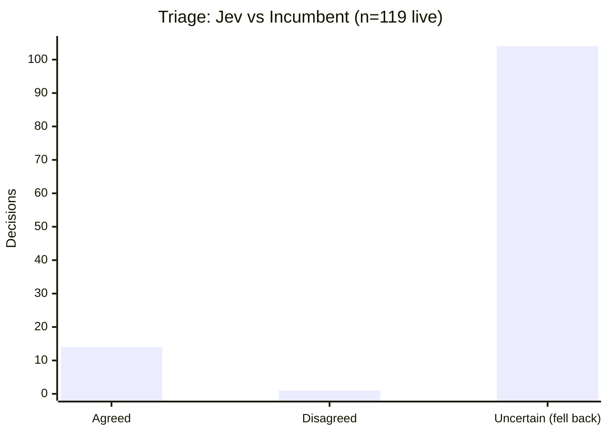
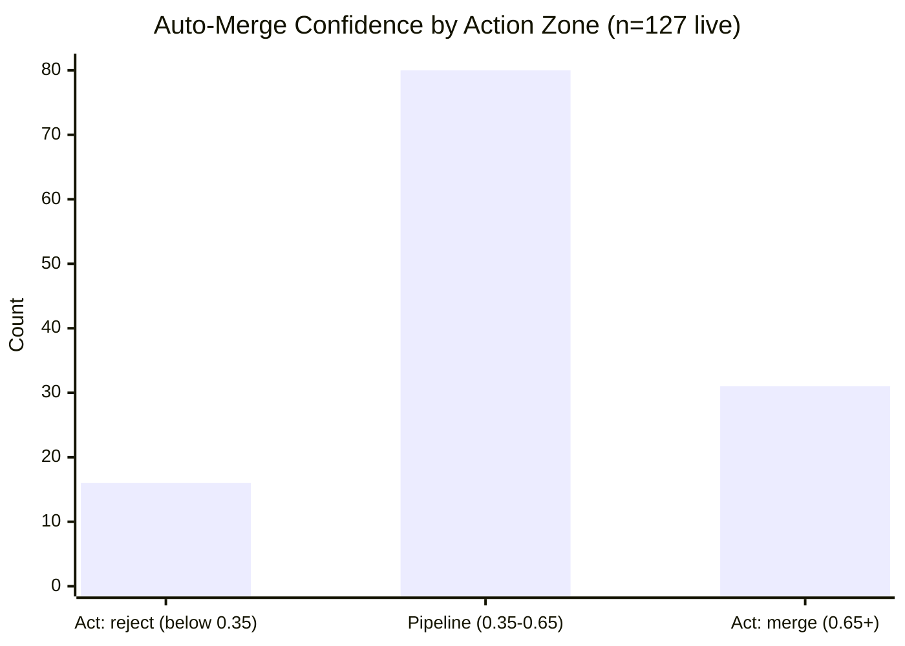
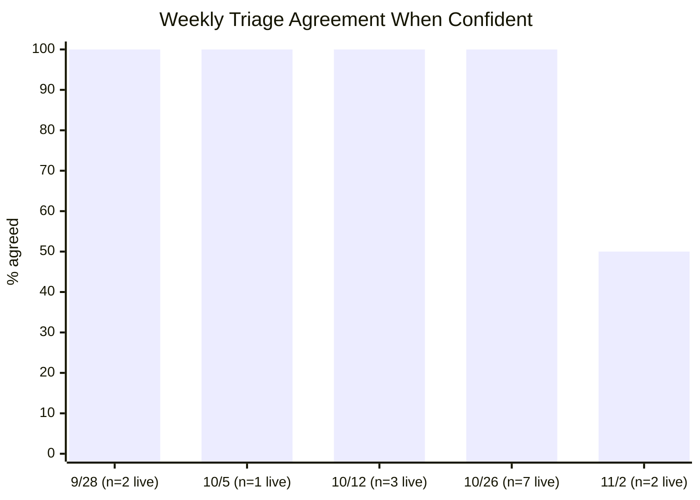
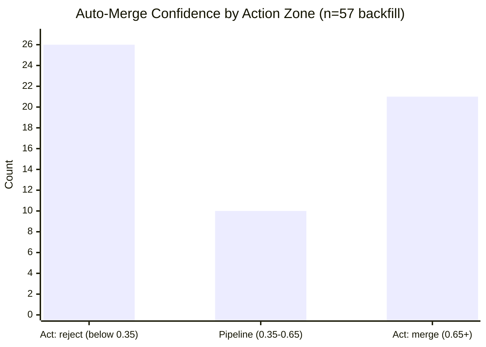

# JEV Report

**Verdict:** Jev agreed on 93% (n=15 live) of confident calls

## Charts

## Counts

- **Total entries:** 338
- **Live entries:** 266
- **Backfilled entries:** 72
- **Date range:** 2026-07-03 to 2026-11-08

## Triage Agreement

- **Agreed:** 14 of 119
- **Disagreed:** 1 of 119
- **Uncertain (fell back):** 104 of 119
- **When confident, agreed:** 14 of 15 — 93% (n=15 live)
- **Disagreement breakdown:**
  - needs-decomposition-vs-rejected: 1

### Weekly Trends

| Week | Agreed | Disagreed | Uncertain | n |
|------|--------|-----------|-----------|---|
| 9/28 | 2 | 0 | 9 | 11 |
| 10/5 | 1 | 0 | 7 | 8 |
| 10/12 | 3 | 0 | 24 | 27 |
| 10/19 | 0 | 0 | 3 | 3 |
| 10/26 | 7 | 0 | 31 | 38 |
| 11/2 | 1 | 1 | 30 | 32 |

## Auto-Merge Agreement

- **Mean confidence:** 0.549 (n=127 live)
- **Median confidence:** 0.550 (n=127 live)
- **Agreement with incumbent decision:** 40/56 — 71% (n=56 live)

### Per-Zone Agreement

| Zone | Agreed | Total | Agreement |
|------|--------|-------|-----------|
| Act: reject (below 0.35) | 1 | 8 | 12% (n=8 live) |
| Pipeline (0.35-0.65) | 29 | 38 | 76% (n=38 live) |
| Act: merge (0.65+) | 10 | 10 | 100% (n=10 live) |

## Backfill

### Backfill Auto-Merge Agreement

- **Mean confidence:** 0.465 (n=57 backfill)
- **Median confidence:** 0.360 (n=57 backfill)
- **Agreement with incumbent decision:** 14/45 — 31% (n=45 backfill)

### Per-Zone Agreement

| Zone | Agreed | Total | Agreement |
|------|--------|-------|-----------|
| Act: reject (below 0.35) | 3 | 26 | 12% (n=26 backfill) |
| Pipeline (0.35-0.65) | 2 | 10 | 20% (n=10 backfill) |
| Act: merge (0.65+) | 9 | 9 | 100% (n=9 backfill) |

## Legend

- **Incumbent decision:** the human/pipeline decision that was actually used
- **Fell back:** Jev returned an uncertain result and deferred to the incumbent
- **Pipeline (0.35–0.65):** confidence too close to call; Jev defers to the incumbent
- **Backfilled:** a decision reconstructed from historical data, not made live
- **n=… live / n=… backfill:** the sample behind a number; live and backfilled decisions are never pooled

---

*Generated at 2026-11-08 21:37 UTC*