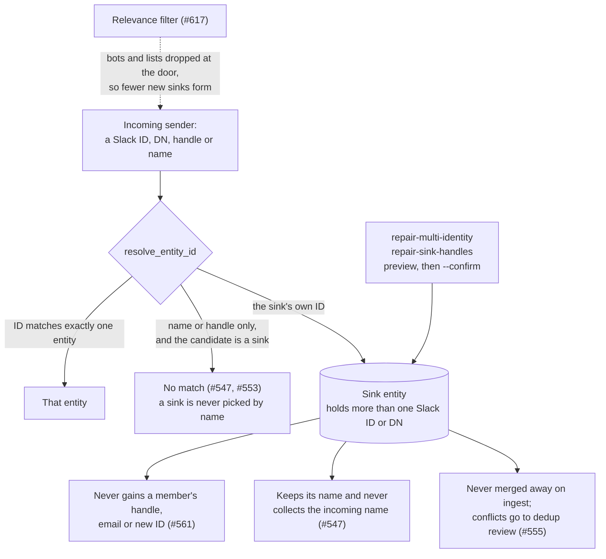

# Identity Resolution: One Person, Many IDs

Patina reads from several communication apps: Slack, Outlook mail and calendar, and IMAP/Gmail. Each app gives the same person a different identifier, and nothing in the data links those identifiers together. To build one belief model per person, Patina has to infer "these identities are the same human" from indirect clues, and a wrong inference corrupts everything built on top of it.

This is the classic **entity resolution** (record linkage) problem. It has been studied since the 1960s, and whole industries (customer data platforms, master data management) exist because nobody fully solves it. This page explains why it is hard, and how Patina keeps it bounded.

The concrete rules are in [Identity Precedence](identity-precedence.md), and the release check is in [Identity Gate](identity-gate.md).

## The difficulty ladder

| Level | Problem | Difficulty |
|---|---|---|
| 1 | Same app, same ID: Slack `U0000000A1` messages twice | Trivial: the ID matches. |
| 2 | Same app, the person's details change: a new display name, a `(Contractor)` suffix | Easy: the ID still anchors it. |
| 3 | Different apps, and a hard identifier overlaps: the same email address appears in Slack and Outlook | Moderate, *if* the payload carries that identifier. Often it doesn't. |
| 4 | Different apps, and only names overlap: Slack `Jordan E.` vs Outlook `Example, Jordan (Contractor)` | Hard: names collide, vary and change. |
| 5 | Things that aren't people look like people: distribution lists, shared mailboxes, bots, the Owner under a dozen IDs | Hard, and it creates fake identities. |
| 6 | Errors compound: one false merge creates a "sink" whose aliases attract more false merges | Very hard: mistakes snowball. |
| 7 | Fixes interact: tightening one rule changes what another code path does | Very hard: every change risks a regression elsewhere. |
| 8 | No open ground truth: real data can't go in tests, and only the Owner knows who is who | This is what keeps it from ever being "done". |

Levels 1–2 are what most people picture. Nearly all the real work is at levels 4–8.

## Why it is hard

### 1. There is no shared key

Each app has its own identifier: Slack user IDs (`U0…`), Exchange legacy DNs (`/O=EXAMPLEORG/…/CN=…`), email addresses (often several per person), handles and display names. No field says that `U0000000A1` and `jordan@example.com` are the same person. Every cross-app link is an inference from indirect evidence: a matching display name, a shared thread, a handle mentioned in text.

### 2. Sources are lossy and inconsistent, even within one app

- Outlook's inbox listing gives **display names** for senders (`"Example, Jordan (Contractor)"`) but **email addresses** for recipients. A rule that needs the sender's domain can't get it from the payload (#633).
- Meeting responses and cancellations arrive in the inbox looking like ordinary email (#580).
- Some items have no received time. Before #611 they were stored dated 1970-01-01.

Fixtures written from what the data was *expected* to look like passed while live data failed (#598, #601). The rule since then: **fixtures come from what the live data does.**

### 3. Names are not identifiers

Names collide (two people called Jordan), vary (`Müller` vs `Mueller`, `Last, First` vs `First Last`, `Bob` vs `Robert`), carry noise (`(Contractor)`, `(External)`), and change over time. Yet across apps, a name is often the only overlapping evidence.

### 4. Non-people look like people

Distribution lists, shared mailboxes, bots, no-reply senders and team channels all come with a name and an address. So does the Owner, under many identifiers at once. Each one is a chance to create a fake person, or to merge real people into a fake one.

### 5. Errors are lopsided, and false merges compound

- **Missed link:** Jordan's Slack and email identities stay separate. That's two half-pictures of one person, which is annoying but contained and fixable later.
- **False merge:** two people become one. Their beliefs blend, contradictions appear that aren't real, and attribution goes wrong.

False merges also spread. If A = B and B = C, then A = C, even when A and C are clearly different people. This is how a **sink** forms: an entity that holds more than one Slack ID or DN. Every alias it holds is another key that new messages can match, so it pulls in more identities over time. The sink guards are listed under [How Patina bounds it](#how-patina-bounds-it).

### 6. Fixes interact

Identity logic is a web of rules, and every caller depends on what the resolver returns. In one case, a fix made `resolve_entity_id` *less* ambiguous, which was correct on its own (#547, #553). But a name lookup inside `upsert_entity` that used to return "ambiguous" now returned a person. That woke a dormant merge path, and the next live ingest merged a sink into a person and deleted it (#555). Each change was right, and together they did damage. That is why every resolver change is now replayed through the [Identity Gate](identity-gate.md).

### 7. There is no open ground truth

Real people's messages can't go into GitHub issues or test fixtures. Every test is an anonymized imitation of a live shape, and imitations drift from the real thing. Only the Owner truly knows who is who, and the Owner's attention is the scarcest resource in the system.

### 8. Undoing is harder than doing

A merge rewrites aliases, claims and relationships. Unmerging needs to know which facts came from which identity. Until #614, claims recorded only a method label (`"extraction"`) instead of the observations they came from, so a bad merge's effects couldn't be traced.

## How Patina bounds it

The problem can't be eliminated, only managed with explicit tradeoffs. Personal scale helps: one Owner, a graph of hundreds to thousands of people, and a human who can confirm.

| Principle | How it is applied |
|---|---|
| **IDs outrank names** | A hard identifier match always beats a name match, and no name-only lookup may override an ID match. See `IDENTIFIER_PRECEDENCE` in [Identity Precedence](identity-precedence.md). |
| **When unsure, don't merge** | An ambiguous name means no match. Uncertain merges go to `patina entity dedup` (preview), and only `--confirm` writes. A missed link is recoverable, and a false merge often isn't. |
| **Sinks are contained** | A sink is never picked by name or handle alone, never gains a member's handle, email or new ID, keeps its own name, and isn't merged on ingest (#547, #553, #555, #561). `repair-multi-identity` and `repair-sink-handles` fix existing ones (preview first). |
| **Keep the raw evidence** | Each observation stores what the app actually sent in `metadata["source"]`: message id, item class, sender key, recipients, raw received time (#611, #612). Later rules work on facts, not guesses. |
| **Keep junk out at the door** | The Outlook relevance filter drops bots, lists and mail that isn't direct or tied to an active objective before it becomes an observation or an entity (#617, #618). There are fewer fake identities to resolve in the first place. |
| **Provenance makes it reversible** | Claims cite the observations they came from (#614). Claims from before that change are reported as unknown provenance, not guessed. |
| **Human gates on anything destructive** | Repairs and cleanups preview by default. The Observer checks live data, and the Owner approves. |
| **Replay before release** | The [Identity Gate](identity-gate.md) replays known-bad identity shapes on a scratch store and checks the invariants before a release. |

## The realistic goal

Patina doesn't aim for perfect identity, because no system with only indirect evidence gets that. The goal is:

- **rarely wrong in the harmful direction:** prefer a missed link to a false merge;
- **every merge traceable and reversible:** keep the raw facts and the provenance;
- **less noise coming in:** most identity bugs started with input that never needed to be ingested.
