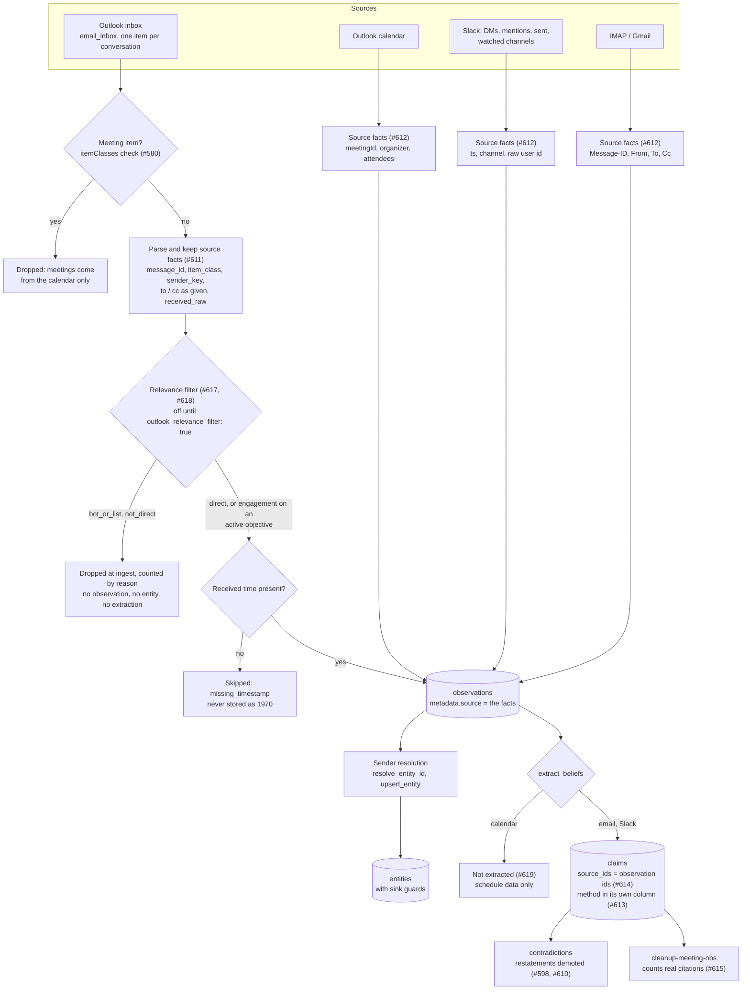
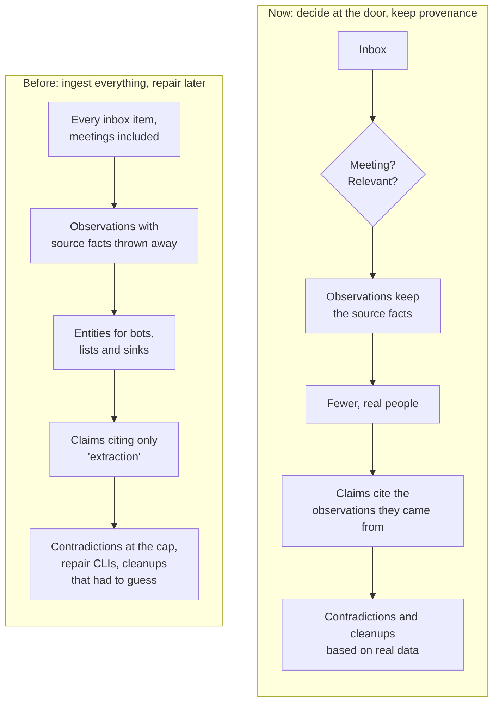

# Ingestion: From Apps to Beliefs

Patina reads messages from Slack, Outlook mail and calendar, and IMAP/Gmail, and turns them into observations, people (entities) and beliefs (claims). The guiding rule is **decide at the door and keep the facts**: filter out what isn't worth knowing before it's stored, keep what each app actually sent, and record where every belief came from.

Identity matching, which decides who each sender is, has its own page: [Identity Resolution](identity-resolution.md).

## The pipeline

### Step by step

1. **Meeting filter.** Outlook puts meeting requests, responses and cancellations in the inbox as if they were email. They're recognized by item class and dropped, because the calendar is the source for meetings.
2. **Source facts.** Every adapter stores what the app actually sent in `metadata["source"]`: the message id, item class, raw sender key, To/Cc recipients and the raw received time. Values are kept as given, and a missing field is left out rather than invented.
3. **Relevance filter (Outlook email, off by default).** An email is kept only if it's **direct** (the Owner is a named To recipient, not only through a distribution list, or is in the thread, and the sender is a person) or tied to an **active objective** (a participant is on the thread, or the sender is from a listed customer domain). Keywords alone never keep an email. Everything else is dropped before it becomes an observation, and each drop is counted by reason. Turn it on with `ingest.outlook_relevance_filter: true` after checking `patina ingest --dry-run`.
4. **Observations.** What's left is stored, deduplicated by source, channel, thread and timestamp.
5. **Sender resolution.** Each sender is matched to an entity. Identifiers beat names, an ambiguous match never merges, and sinks can't absorb more identities. See [Identity Resolution](identity-resolution.md).
6. **Belief extraction.** Email and Slack observations go to `extract_beliefs`. Calendar observations don't: they're schedule data only.
7. **Claims cite their sources.** Each claim records the observation ids it came from, and its extraction method is stored separately. A re-confirmed claim adds ids instead of replacing them.

## Before and now

Most of the identity and contradiction bugs fixed in October and November 2026 started with input that never needed to be stored: notifications, bots, distribution lists and meeting items. The current design removes that noise at ingest, before any later stage has to clean it up.

## What's live and what isn't

| Piece | State |
|---|---|
| Meeting filter, source facts, missing-timestamp skip, no calendar extraction | Live. Applies from the next ingest. |
| Relevance filter | **Off by default.** Fill in objectives first (`patina objectives update --participant … --customer-domain …`), check `patina ingest --dry-run`, then set `ingest.outlook_relevance_filter: true`. The customer-domain rule needs #633, because live Outlook senders are display names with no address. |
| Claim provenance | New claims only. Claims from before #614 are reported as unknown provenance and can't be backfilled reliably. |
| Rows stored before #611 | Have no source facts, so the relevance rule can't be applied to them afterwards. |
| Pre-fix meeting rows | `patina cleanup-meeting-obs` previews which rows it would remove. Removing them needs `--confirm` and the Owner's approval. |
